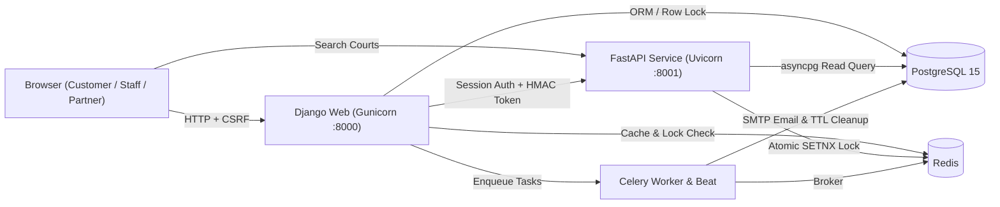

# 🏸 BadmintonPro — Real-Time Badminton Court Booking & Management Platform

[](https://github.com/Tuandayneee/badminton-booking-platform/actions/workflows/ci.yml)

Nền tảng quản lý và đặt sân cầu lông toàn diện cho **Người chơi (Customer)**, **Nhân viên thu ngân (Staff)** và **Chủ sân (Partner)** — kết hợp Django (Monolith & Admin/POS/Dashboard), FastAPI (Realtime Search & Distributed Redis Slot Locking), Celery (Async Emails & TTL Auto-Cancel), PostgreSQL và Redis.

---

## 🏗 Kiến trúc hệ thống



### Điểm nhấn kỹ thuật & Bảo mật
- **Chống Race Condition (Double Booking):** Kết hợp khóa phân tán Redis (`SET NX EX 600` qua FastAPI) + khóa hàng database (`SELECT ... FOR UPDATE` trong `transaction.atomic()`) + `UniqueConstraint` ở tầng PostgreSQL.
- **Bảo vệ API giữ chỗ:** Trình duyệt gọi Django proxy (`/booking/api/lock-slot/`) đã xác thực session & CSRF; Django ký `X-Internal-Token` (HMAC-SHA256) gửi sang FastAPI — chặn giả mạo `user_id`.
- **Chống Price Tampering & Âm kho:** Toàn bộ giá đặt sân (`Court.get_price_at_time`) và đơn POS (`Product.price`) được tính và kiểm tra tồn kho lại hoàn toàn trên server trong transaction nguyên tử.
- **Phân quyền & IDOR Protection:** Kiểm tra quyền sở hữu cơ sở (`partner=request.user.partner_profile`) trên toàn bộ thao tác CRUD sân, nhân viên, lịch đặt, doanh thu và duyệt giao dịch.

---

## 🛠 Tech Stack

- **Backend Core:** Python 3.13, Django 6.0, Django Allauth (Google / GitHub OAuth)
- **Realtime Microservice:** FastAPI, Uvicorn, `asyncpg`, `redis.asyncio`
- **Database & Cache:** PostgreSQL 15, Redis
- **Background Jobs:** Celery Worker & Celery Beat (gửi email HTML, tự động hủy đơn quá hạn 10 phút)
- **Reporting & Exports:** `openpyxl` (xuất báo cáo Excel `.xlsx`), Chart.js
- **Frontend:** HTML5, CSS3, Bootstrap 5, Vanilla JS (DOM API an toàn chống XSS)
- **DevOps & CI:** Docker, Docker Compose, WhiteNoise, GitHub Actions (`ruff` + `manage.py test`)

---

## ✨ Tính năng chính

1. **Khách hàng (Customer)**
   - Đăng ký/đăng nhập, quên/đặt lại mật khẩu qua email token, đăng nhập Google/GitHub.
   - Tìm kiếm sân trống theo khu vực, ngày và khung giờ qua FastAPI.
   - Chọn sân trực quan trên Booking Timeline (hỗ trợ giờ thường / giờ vàng), giữ chỗ 10 phút, thanh toán VietQR, theo dõi lịch sử & tích điểm nâng hạng thành viên (Bronze → Diamond).
   - Trợ lý Chatbot hỗ trợ hỏi đáp nhanh.
2. **Nhân viên (Staff)**
   - Giao diện POS bán đồ uống/dịch vụ tại quầy (Tiền mặt / Chuyển khoản), trừ tồn kho nguyên tử.
   - Thống kê doanh thu và hóa đơn dịch vụ theo ngày và biểu đồ 7 ngày.
3. **Chủ sân (Partner)**
   - Dashboard tổng quan doanh thu ngày, tỷ trọng tiền mặt vs chuyển khoản, biểu đồ 7 ngày.
   - Quản lý cơ sở, sân, khung giờ vàng, nhân viên theo chi nhánh, CRM khách hàng.
   - Duyệt giao dịch chuyển khoản (idempotent), tự động cập nhật doanh thu & điểm thưởng.
   - Xuất báo cáo doanh thu, cơ sở, giao dịch ra file Excel (`.xlsx`).

---

## ⚙️ Cài đặt & Chạy dự án (Docker Compose)

> **Lưu ý:** Nếu bạn chưa đổi tên repo trên GitHub từ `booking_batminton` sang `badminton-booking-platform`, hãy dùng đúng URL repo hiện tại của bạn khi clone.

### 1. Clone repo & cấu hình biến môi trường
```bash
git clone https://github.com/Tuandayneee/badminton-booking-platform.git
cd badminton-booking-platform
cp .env.example .env
```
Điền các giá trị thật (như `SECRET_KEY`, `POSTGRES_PASSWORD`, `INTERNAL_LOCK_SECRET`, `EMAIL_*`) vào file `.env`.

### 2. Khởi chạy toàn bộ dịch vụ
```bash
docker compose up -d --build
```
Lệnh này sẽ khởi chạy 6 container: `db` (PostgreSQL), `redis`, `web` (Django), `celery`, `beat`, và `fastapi`.

### 3. Chạy Migration & Tạo Superuser
```bash
docker compose exec web python manage.py migrate
docker compose exec web python manage.py createsuperuser
```

### 4. Truy cập hệ thống
- Web App (Customer / Staff / Partner): `http://localhost:8000`
- Django Admin: `http://localhost:8000/admin`
- FastAPI Docs (Swagger): `http://localhost:8001/docs`

---

## 🔐 Danh sách biến môi trường (`.env.example`)

| Biến | Mô tả | Mặc định (Dev) |
| :--- | :--- | :--- |
| `SECRET_KEY` | Django secret key (bắt buộc khi `DEBUG=False`) | — |
| `DEBUG` | Bật/tắt chế độ debug | `False` |
| `ALLOWED_HOSTS` | Danh sách host hợp lệ (phân tách bằng dấu `,`) | `localhost,127.0.0.1` |
| `CSRF_TRUSTED_ORIGINS` | Origins được phép gửi CSRF POST | `http://localhost:8000,http://127.0.0.1:8000` |
| `DATABASE_URL` | Chuỗi kết nối PostgreSQL (`postgresql://...`) | — |
| `DB_HOST`, `DB_NAME`, `DB_USER`, `DB_PASS`, `DB_PORT` | Tham số PostgreSQL (fallback nếu không dùng `DATABASE_URL`) | `db`, `badminton_db`, ... |
| `USE_SQLITE` | Dùng SQLite cục bộ khi không chạy Docker | `False` |
| `REDIS_URL` | Redis URL cho lock & Celery | `redis://redis:6379/0` |
| `CACHE_REDIS_URL` | Redis URL cho Django Cache | `redis://redis:6379/1` |
| `FASTAPI_PUBLIC_URL` | URL FastAPI phía trình duyệt gọi | `http://localhost:8001` |
| `FASTAPI_INTERNAL_URL` | URL nội bộ Docker để Django gọi FastAPI | `http://fastapi:8001` |
| `CORS_ORIGINS` | Origins cho phép CORS trên FastAPI | `http://localhost:8000,http://127.0.0.1:8000` |
| `INTERNAL_LOCK_SECRET` | Secret HMAC-SHA256 ký token khóa sân giữa Django & FastAPI | — |
| `SUPPORT_PHONE` | Hotline hiển thị trên email & trang xác nhận | `0900.000.000` |
| `EMAIL_HOST_USER`, `EMAIL_HOST_PASSWORD` | Tài khoản SMTP gửi email thông báo | — |

---

## 🧪 Chạy kiểm thử & Linter (Local)

```bash
# Cài dependencies (trong virtualenv)
pip install -r requirements.txt
pip install fastapi uvicorn asyncpg pydantic ruff

# Kiểm tra linter & migrations
ruff check .
USE_SQLITE=True DEBUG=True python manage.py check
USE_SQLITE=True DEBUG=True python manage.py makemigrations --check --dry-run

# Chạy toàn bộ unit & integration tests (tự động dùng SQLite in-memory & LocMemCache)
python manage.py test --verbosity=2
```

---

## 📸 Screenshots

> Thêm ảnh chụp màn hình thực tế của các trang **Booking Timeline**, **Partner Dashboard**, và **Staff POS** vào thư mục `docs/screenshots/` và nhúng vào đây sau khi chạy Docker local.
